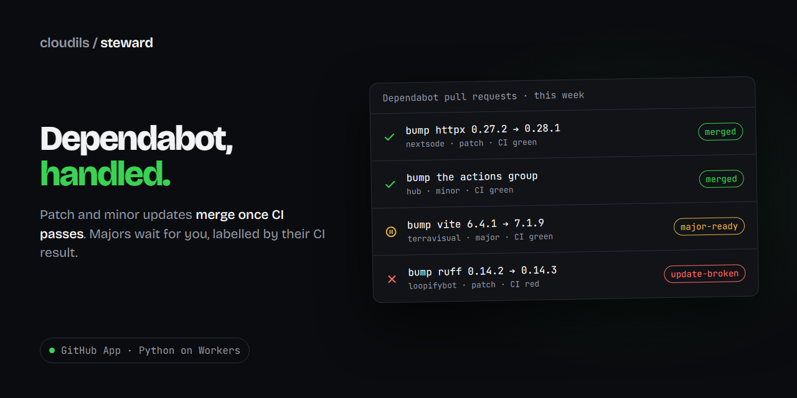
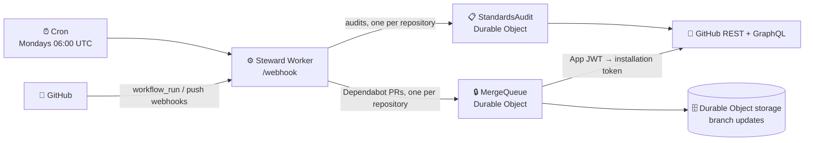

<p align="center">
  
</p>

<p align="center">
  <a href="https://github.com/Isma-L154/Steward/actions/workflows/ci.yml"></a>
  <a href="https://github.com/Isma-L154/Steward/actions/workflows/deploy.yml"></a>
  
  
  <a href="LICENSE"></a>
</p>

<p align="center">
  <b>A GitHub App that clears Dependabot pull requests across all your repositories.</b><br>
  Patch and minor updates merge once CI passes; majors wait for you, labelled by their CI result.
</p>

<p align="center">
  <a href="https://github.com/Isma-L154/Steward/issues">Report a bug</a> ·
  <a href="#running-locally">Run it locally</a>
</p>

---

## What it does

- **Merges safe updates by itself** — a Dependabot patch or minor update is approved and merged as soon as every check on it passes, using the repository's merge method (squash first).
- **Never merges a major** — a major update gets `major-ready` when CI passes or `major-broken` when it fails, and waits for you.
- **Flags broken updates** — a patch or minor update with failing CI gets `update-broken`, and one whose branch GitHub will not let Steward update gets `update-blocked`; both go away once it merges.
- **One update at a time per repository** — evaluations for a repository run one after another, and an update behind `main` gets its branch updated with `main` (once per head commit), so CI runs on the real combination before it merges.
- **Fails closed** — no auto-merge in a repository whose `main` has no required status checks, when a required check never reported, when the update type is unclear, or when anyone but Dependabot (or Steward's own branch update) pushed a commit to the branch.
- **Checks every repository against one set of rules** — on every push to the default branch and every Monday, it checks CI triggers, pinned actions, workflow permissions and concurrency, Dependabot coverage, required checks, direct pushes, issue references, commit identity, AI attribution, the README standard and the `AGENTS.md` security baseline.
- **One issue per repository, never noise** — what fails is listed in a single "Repository standards" issue, updated in place, reopened if something breaks again and closed when everything passes.
- **Leaves alone what you exclude** — archived repositories and any repository with the `steward-ignore` topic are skipped by everything Steward does.

The design is in [`docs/superpowers/specs/2026-10-18-steward-design.md`](docs/superpowers/specs/2026-10-18-steward-design.md).

## How it works



GitHub sends a `workflow_run` webhook when a CI run finishes. The Worker verifies its signature, keeps only pull requests on `dependabot/` branches, and hands each one to the `MergeQueue` Durable Object for its repository. That object holds a lock, so two updates are never merged onto the same `main` without CI running in between.

The queue reads the pull request, its commits, the required checks (rulesets and classic branch protection) and every check run and commit status, then a pure decision table (`src/steward/dependabot/decision.py`) says what to do. The update type comes from the metadata block Dependabot writes into its commit message; anything missing or unknown counts as major.

For the rules, a push to a repository's default branch (or the weekly cron, which lists every installed repository) asks the `StandardsAudit` Durable Object for that repository. One GraphQL query plus three REST calls build a snapshot (workflows, Dependabot config, README, `AGENTS.md`, the file tree, required checks, the last 30 days of commits and merged pull requests); pure checks in `src/steward/standards/` turn it into findings. One audit per Durable Object call keeps each audit inside the free plan's 50 subrequests per invocation.

The App JWT is signed with the runtime's native WebCrypto, not with a Python RSA library: RSA compiled to WebAssembly costs more CPU time than a request may use. GitHub's PKCS#1 key is wrapped as PKCS#8 for it (`src/steward/github/keys.py`), and the main Worker never touches the key; only the queue signs, about once an hour per repository.

**Stack:** Python 3.14 · Cloudflare Python Workers · Durable Objects · Cron Triggers · WebCrypto · `pydantic` · PyYAML · uv + pywrangler

## Running locally

Needs Python 3.14, [uv](https://docs.astral.sh/uv/) and Node.js 24.

```bash
npm ci                                  # wrangler
uv sync                                 # Python dependencies
uv run pytest                           # unit tests, offline
uv run ruff check . && uv run ruff format --check .
uv run mypy src tests

cp .dev.vars.example .dev.vars          # fill in the values below
uv run pywrangler dev --test-scheduled  # http://localhost:8787/health
uv run pytest -m integration            # against the running dev server
```

| Variable | Description |
| -------- | ----------- |
| `APP_ID` | The GitHub App's ID, from its settings page. |
| `PRIVATE_KEY` | The App's private key (PEM), generated on its settings page. Locally any RSA key works: `openssl genpkey -algorithm RSA -pkeyopt rsa_keygen_bits:2048`. |
| `WEBHOOK_SECRET` | The webhook secret set on the App. The integration tests sign with `STEWARD_WEBHOOK_SECRET` (default `ci-webhook-secret`). |

> ⚠️ `.dev.vars` is git-ignored and must never be committed.

`OWNER_EMAIL`, the email the owner's commits must carry, is a plain variable in `wrangler.toml`. With `--test-scheduled`, `curl "http://localhost:8787/cdn-cgi/local/scheduled?cron=0+6+*+*+1&format=json"` runs the weekly sweep once.

On Windows with the repository outside `C:`, Pyodide only sees the current drive: set `UV_CACHE_DIR` and `UV_PYTHON_INSTALL_DIR` to folders on the repository's drive before running `pywrangler`.

`uv run pywrangler deploy --dry-run --outdir .wrangler/dry-run` bundles the Worker without deploying, as CI does.

The banner is drawn in `docs/brand/banner.src.html`. Regenerate it with:

```bash
node docs/brand/build-banner.mjs
npx -y playwright@1.63.0 screenshot --viewport-size "1280,640" "file:///<absolute path>/docs/brand/banner.html" docs/brand/banner.png
```

## Deployment

Every push to `main` runs `deploy.yml`: the full CI, then `pywrangler deploy` with the commit as `BUILD_VERSION`, then a wait until `https://steward.cloudils.com/health` reports that version.

- Repository secret `CLOUDFLARE_API_TOKEN` (allowed to deploy Workers and their custom domain) and repository variable `CLOUDFLARE_ACCOUNT_ID`.
- Worker secrets `APP_ID`, `PRIVATE_KEY`, `WEBHOOK_SECRET`, set once with `uv run pywrangler secret put <NAME>`.

First-time setup of the GitHub App (Settings → Developer settings → GitHub Apps → New):

- Webhook URL `https://steward.cloudils.com/webhook` and a generated secret.
- Repository permissions: Metadata read, Contents read and write, Pull requests read and write, Issues read and write, Checks read, Commit statuses read, Actions read, Administration read.
- Events: Workflow run and Push. Installable only on this account.
- Private key: **Credentials → Key pairs** on the App's settings page; the downloaded `.pem` goes into the `PRIVATE_KEY` Worker secret (`uv run pywrangler secret put PRIVATE_KEY < <file>.pem`).
- Install it on the repositories it should look after; it acts only where it is installed.

## Security

- **Secrets:** the App key, ID and webhook secret are Worker secrets only; any missing or unparseable one makes every route, `/health` included, answer 500.
- **Webhook authentication:** `X-Hub-Signature-256` is checked with HMAC-SHA256 and a constant-time comparison over the raw body before anything is parsed; failures answer 401.
- **Input validation:** strict pydantic models for the fields used, no coercion; bodies over 1 MiB or without a declared length answer 413, malformed ones 400.
- **Rate limiting:** 120 webhook requests per minute per client IP.
- **Least privilege:** installation tokens are short-lived and cached until five minutes before they expire; errors log the status and path, never a token or a payload.
- **Headers:** every response carries `Content-Security-Policy: default-src 'none'; frame-ancestors 'none'; base-uri 'none'`, HSTS, `nosniff`, `Referrer-Policy: no-referrer` and `Cache-Control: no-store`.
- CORS and Row Level Security do not apply: no browser calls this Worker and there is no multi-user data (see `AGENTS.md`).

## License

[MIT](LICENSE). Bricolage Grotesque and JetBrains Mono, used in the banner, are under the SIL Open Font License (`docs/brand/fonts/OFL-*.txt`).
