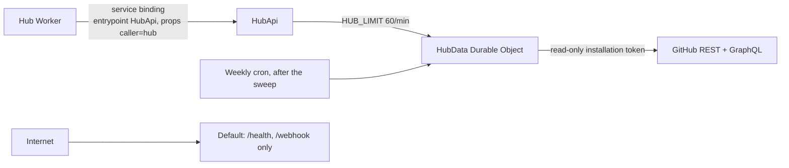

# Steward hub API design

Step 4 of [the Steward design](2026-10-18-steward-design.md): the read-only API the hub (`hub.cloudils.com`, Isma-L154/hub#11) uses to show each repository's health and the weekly report of pending work. It settles what that design left open: the JSON shape, where the cache and the report live, and how the latest deploy is found. Threats and their tests: [docs/threat-models/2026-10-19-hub-api.md](../../threat-models/2026-10-19-hub-api.md).

## Intent

The owner wants to see from the hub, without opening GitHub repository by repository, whether each project is healthy on the code side and what is waiting for them. Steward is the only component with GitHub credentials. The hub reads everything from Steward and holds no GitHub token.

The owner asked for the API to be as secure as possible and handed the architecture to the builder. Every decision below is **the builder's call** unless marked otherwise. The owner approved the health and report contents in conversation on 2026-10-19.

## Goals

1. `GET /v1/health`: health for every managed repository in one response.
2. `GET /v1/report`: the latest weekly report of pending work, with the time it was generated.
3. Both reachable only through the hub's service binding, never from the internet.
4. Never spend enough of the installation's GitHub rate limit to slow the merge queue.
5. Anything unclear reads `unknown`, never a guess.

## Non-goals

- Acting on repositories (merge, re-run, close). The API is read-only.
- Per-repository endpoints or filtering. The hub gets everything and maps it to its catalog.
- Historical data or trends. The API serves current health and the latest report only.
- Anything hub-side: the route, the Access check and the rendering belong to hub#11.

## Anti-goals

- A path that answers on `steward.cloudils.com` or on a preview URL.
- A green CI or a successful deploy shown when GitHub did not say so plainly.
- An empty report stored after a failed generation, which would read as "nothing pending".
- Text or links in a response that could run script or point anywhere but `https://github.com/` once rendered.

## Architecture



### Transport

- `src/steward/worker/hub_api.py` defines `HubApi(WorkerEntrypoint)`, exported from `src/entry.py` next to `Default`. Wrangler routes the custom domain to `Default`, so `HubApi` has no public route.
- The hub binds to it with `{"binding": "STEWARD", "service": "steward", "entrypoint": "HubApi", "props": {"caller": "hub"}}` and calls `env.STEWARD.fetch("https://steward/v1/health")`. HTTP with JSON, not RPC methods, so both sides test plain status codes and bodies, including hub#11's "malformed response" case.
- `HubApi.fetch` checks, in this order:
  1. config loads, else 500 `misconfigured`;
  2. `ctx.props.caller == "hub"`, else 403 `forbidden`;
  3. `HUB_LIMIT` keyed by the caller, else 429 `rate_limited`;
  4. the method is `GET`, else 405 `method_not_allowed`;
  5. no query string and no body, else 400 `invalid_request`;
  6. the path is exactly `/v1/health` or `/v1/report`, else 404 `not_found`.
  It then forwards to the single `HubData` instance (`getByName("hub")`).
- `wrangler.toml` gains `preview_urls = false`, the `HUB_LIMIT` rate limit (`limit = 60, period = 60`, its own `namespace_id`), the `HubData` Durable Object binding and migration `v3` (`new_sqlite_classes = ["HubData"]`).
- `Default` is unchanged: `/v1/*` keeps answering 404 there.

### HubData Durable Object

`src/steward/worker/hub_data.py`, one instance for the whole account. Its invocation has its own subrequest budget, separate from the cron's. It is serialized with an `asyncio.Lock`, like `MergeQueue`. Routes, internal to the Worker:

- `/health`: returns the stored health if it is under 5 minutes old. Otherwise it refreshes while holding the lock, so concurrent callers wait for that one refresh instead of starting their own, then stores and returns the result. A failed refresh answers 502 `github_unavailable` and does not serve stale data. The hub shows unknown.
- `/report`: returns the stored report. If none was ever stored, it builds one once (holding the lock) and stores it on success.
- `/build-report`: called by `scheduled` right after the sweep, whether or not the sweep succeeded, since the report reads GitHub's current state. It builds the report and stores it only on full success. On failure it keeps the previous report and logs the error.

Health and the report come from the same GitHub snapshot (below). A report build therefore also refreshes the health cache.

### Reading GitHub

Each refresh makes a fixed number of calls, whatever the repository count:

1. `installation_ids` (App JWT). One installation is expected; each extra one adds calls 2 to 4.
2. A **read-only installation token**: `POST /app/installations/{id}/access_tokens` with `{"permissions": {"metadata": "read", "contents": "read", "pull_requests": "read", "issues": "read", "checks": "read", "statuses": "read", "deployments": "read", "vulnerability_alerts": "read"}}`. `InstallationTokens` takes an optional permission set and caches each set separately. The merge queue and audits keep using the full token.
3. `GET /installation/repositories?per_page=100` (existing `installed_repositories`), kept to managed repositories (`repos.is_managed`).
4. **One GraphQL query** with one aliased `repository(owner:, name:)` block per managed repository (`r0`, `r1`, …), with owner and name passed as variables, never interpolated. Per repository it reads:
   - `defaultBranchRef.target` (Commit): `committedDate`, `statusCheckRollup { state }`
   - `deployments(environments: ["production"], first: 1, orderBy: {field: CREATED_AT, direction: DESC}) { nodes { createdAt latestStatus { state } } }`
   - `pullRequests(states: OPEN, first: 100) { totalCount nodes { number title author { login } labels(first: 20) { nodes { name } } } }`
   - `issues(states: OPEN) { totalCount }`
   - `standards: issues(states: OPEN, labels: ["standards"], first: 5) { nodes { number author { login } body } }`
   - `vulnerabilityAlerts(states: OPEN, first: 100) { nodes { securityVulnerability { severity } } }`

The response is parsed with strict pydantic models into frozen dataclasses (`RepoSnapshot` for the hub, in `src/steward/hub/`). Parsing rules:

- An entry in `errors` whose `path` is a repository alias makes every field of that repository `unknown` or `null`. So does a repository missing from `data`.
- An entry whose `path` goes deeper (for example `["r3", "vulnerabilityAlerts"]`) makes only that field `unknown` or `null`.
- A response that does not parse at all fails the refresh (502).

### Pure core: `src/steward/hub/`

No Workers imports, tested on CPython, same conventions as `dependabot/` and `standards/`:

- `snapshot.py`: the frozen dataclasses.
- `health.py`: `health(snapshots, now) -> Health`, including the state mappings below.
- `report.py`: `report(snapshots, now) -> Report`.
- `health.py` and `report.py` build the JSON below from an explicit field list; GitHub JSON is never passed through. (Planned as a separate `contract.py`; folded in during implementation.)
- `text.py`: title cleaning (Unicode categories `Cc` and `Cf` removed, which includes bidi overrides; whitespace collapsed; cut to 200 characters) and URL building.
- `github/hub_client.py` holds the query and the parsing, behind a small `Protocol` port so `HubData` is tested with a fake.

### State mappings

| Field | GitHub value | API value |
|---|---|---|
| `ci` | `statusCheckRollup.state` `SUCCESS` | `passing` |
| | `FAILURE`, `ERROR` | `failing` |
| | `PENDING`, `EXPECTED` | `running` |
| | null rollup, no default branch, anything else | `unknown` |
| `deploy.state` | latest `production` deployment `latestStatus.state` `SUCCESS` | `succeeded` |
| | `FAILURE`, `ERROR` | `failed` |
| | `PENDING`, `QUEUED`, `IN_PROGRESS`, `WAITING` | `running` |
| | no deployment, no status, `INACTIVE`, anything else | `unknown` |
| `standards.state` | an open `standards` issue created by the App | `failing` |
| | no such issue | `passing` |
| | repository unreadable | `unknown` |

Deploys are found through GitHub's `production` environment, which the owner's CI/CD rule already requires for deploy jobs. A repository that deploys outside Actions reads `unknown`; nothing is guessed from workflow names. `ci` is the combined state of `main`'s head commit, so a failed deploy job on that commit also shows as failing CI (accepted trade-off). `standards` reads `passing` for a repository that has never been audited yet. Every push to `main` triggers an audit, so this lasts minutes (accepted).

Identity rules:
- A Dependabot PR is one whose `author.login` is `dependabot`, GraphQL's login for the `dependabot[bot]` app; confirm against a real response.
- The App's own issues are matched the same way against its GraphQL login, derived from `bot_login`.
- `findings` is the number of unchecked `- [ ]` lines in the standards issue body.

## Contract

All times are ISO 8601 UTC with `Z`. All `url` values are built by Steward from validated parts and match `^https://github\.com/[A-Za-z0-9-]+/[A-Za-z0-9._-]+(/(pull|issues)/[0-9]+)?$`. Repositories are sorted by `repo`, report items by `repo` then number.

### `GET /v1/health` → 200

```json
{
  "generated_at": "2026-10-19T12:00:00Z",
  "repositories": [
    {
      "repo": "Isma-L154/nextsode",
      "url": "https://github.com/Isma-L154/nextsode",
      "ci": "passing",
      "deploy": { "state": "succeeded", "at": "2026-10-18T21:04:11Z" },
      "last_commit_at": "2026-10-18T20:59:02Z",
      "pull_requests": { "open": 3, "dependabot": 2 },
      "issues": { "open": 1 },
      "security_alerts": { "critical": 0, "high": 1, "medium": 0, "low": 0 },
      "standards": { "state": "failing", "url": "https://github.com/Isma-L154/nextsode/issues/7", "findings": 4 }
    }
  ]
}
```

- `pull_requests.dependabot` is `null` when more than 100 pull requests are open, since the count would be short.
- When a field cannot be read: `ci`, `deploy.state` and `standards.state` read `unknown`; `deploy.at` and `last_commit_at` are `null`; the count objects are `null`; `standards.url` and `standards.findings` are `null` unless `state` is `failing`.
- `issues.open` counts every open issue, the standards issue included.
- `security_alerts` counts by severity only, never advisory details.

### `GET /v1/report` → 200

```json
{
  "generated_at": "2026-10-19T06:03:12Z",
  "major_ready":     [{ "repo": "Isma-L154/hub", "number": 12, "title": "Bump wrangler from 4.x to 5.0", "url": "https://github.com/Isma-L154/hub/pull/12" }],
  "major_failing":   [],
  "updates_failing": [],
  "updates_blocked": [],
  "standards":       [{ "repo": "Isma-L154/nextsode", "url": "https://github.com/Isma-L154/nextsode/issues/7", "findings": 4 }],
  "unknown":         []
}
```

- `major_ready`, `major_failing`, `updates_failing` and `updates_blocked` are open Dependabot PRs carrying the `major-ready`, `major-broken`, `update-broken` and `update-blocked` label. A PR by anyone else is left out even if labelled.
- `updates_blocked` is an addition to the original design: branch updates GitHub refused (#18) also wait for the owner.
- Only what is open when the report is generated appears.
- `unknown` lists the repositories whose pull requests or standards issue could not be read; they get no items in the other lists, so none of them reads as having nothing pending.

### Errors

Every error is `{"error": "<code>"}` with nothing else. The codes:

| Status | Code |
|---|---|
| 400 | `invalid_request` |
| 403 | `forbidden` |
| 404 | `not_found` |
| 405 | `method_not_allowed` |
| 429 | `rate_limited` |
| 500 | `misconfigured` |
| 502 | `github_unavailable` |

Every response carries the existing `API_HEADERS`.

The contract is also written as `docs/hub-api.md` for the hub's builder. hub#11 gets a comment linking it, posted only once the owner agrees. That document states what the hub must do:
- bind with the entrypoint and props above;
- treat any non-200 or any body that fails its own validation as unknown;
- render every string with `textContent`;
- use only the `url` values given.

## Security

The threat model is authoritative. Each of its ten mitigations ships with the test it names. In brief:
- the API exists only on `HubApi`, `preview_urls` is off, and the deploy workflow checks that `https://steward.cloudils.com/v1/health` answers 404;
- `ctx.props` caller check;
- read-only token;
- field allowlist and fixed error codes;
- Dependabot-only and App-only report items, cleaned titles and built URLs;
- strict parsing to `unknown`;
- single-flight 5-minute cache plus `HUB_LIMIT`;
- a fixed GitHub call count;
- a strict request shape;
- a report replaced only on success.

Baseline controls in `AGENTS.md`:
- **2 (CORS):** stays N/A.
- **3 (validation):** gains the request-shape rule.
- **5 (rate limiting):** gains `HUB_LIMIT`.
- **7 (headers):** covers the new entrypoint.

No new secrets and no new dependencies.

## Owner's manual steps

- **Before the first deploy of this feature:** in the App settings, add the repository permissions **Deployments: read** and **Dependabot alerts: read**, then accept the updated permissions on the installation. GitHub refuses a scoped token that asks for a permission the App lacks. Until both are granted, every refresh fails and the API answers 502; the hub shows unknown and nothing else breaks.
- Repositories should deploy through a job with `environment: production` so their deploys show up.

## Build order

0. **Spike (throwaway), before the plan's first task.** Run `pywrangler dev` with a throwaway JavaScript Worker bound to `HubApi` with `props`. Confirm that a Python named entrypoint's `fetch` is reachable through the binding, that `self.ctx.props` arrives, and that the custom domain does not reach it. If `ctx.props` does not reach Python, stop and bring it back to the owner instead of weakening control 2. [Opus 5: unknown runtime behaviour, decides whether the design holds]
1. Read-only token support in `InstallationTokens`. [Sonnet 5: small, well-specified, security-sensitive tests]
2. `hub/` core: snapshot, mappings, health, report, text, contract, with property tests for URLs and titles. [Sonnet 5: pure functions fully specified here]
3. `github/hub_client.py`: query builder and strict parsing, with malformed-response tests. [Opus 5: GraphQL shape and failure semantics need judgment]
4. `HubData` Durable Object: cache, single-flight, report storage, cron hook. [Opus 5: concurrency and failure handling]
5. `HubApi` entrypoint, `wrangler.toml` changes, deploy-workflow 404 check. [Sonnet 5: specified checks in a fixed order]
6. `docs/hub-api.md`, `AGENTS.md` baseline lines, README via `docs-sync`. [Sonnet 5: documentation against a settled contract]
7. `security-scan`, `differential-review`, `code-review` before merge. [Opus 5: security-sensitive review]

## Left to the builder

- Module boundaries inside `src/steward/hub/` beyond those named here.
- Storage keys and the serialization format inside `HubData`.
- The exact `namespace_id` for `HUB_LIMIT`.
- How the integration tests reach `HubApi` locally, as long as the default-entrypoint 404 and the props check are covered.
