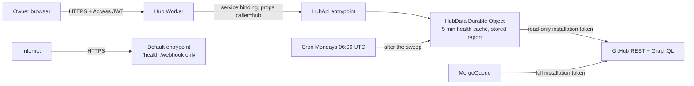

# Threat model: hub API

- **Date:** 2026-10-19
- **Scope:** the read-only API Steward serves to the hub (step 4 of the design): a named `HubApi` Worker entrypoint, reachable only through the hub's service binding, with `GET /v1/health` (per-repository health, cached 5 minutes in a Durable Object) and `GET /v1/report` (the weekly report of pending work, built after the Monday sweep). Out of scope: the hub's own route, its Access check and its rendering (Isma-L154/hub#11), and the existing webhook and merge paths, except where the API shares their GitHub budget.

## Elements

| Assets | Actors | Entry points | Trust boundaries |
|---|---|---|---|
| App private key and installation tokens (write access to every installed repository) | Owner, through the hub behind Cloudflare Access | `HubApi.fetch` (service binding only) | Internet → `steward.cloudils.com` (default entrypoint only) |
| Private repository data: names, PR and issue titles, CI and deploy state, open security alert counts | Hub Worker (trusted caller, identified by binding `props`) | Weekly cron (`scheduled`) | Hub Worker → `HubApi` (service binding with `props`) |
| GitHub rate limit of the installation, shared with the merge queue | Other Workers in the same Cloudflare account | Default entrypoint (`/health`, `/webhook`), already modeled | `HubApi` / `HubData` → GitHub API (third-party data, partly attacker-influenced) |
| Availability of the merge queue and of the hub page | Internet attacker; anyone able to open a PR or set a label on an installed repository | | Steward JSON → hub page (text rendered in the owner's browser) |

## Data flow

## Threats

| # | STRIDE | Threat | Likelihood | Impact | Existing control | Gap | Mitigation | Verification |
|---|---|---|---|---|---|---|---|---|
| 1 | I / E | Someone on the internet reads repository health or the report through `steward.cloudils.com` or a preview URL | Medium | High | Custom domain only, `workers_dev = false` | The API must not exist on the default entrypoint; `preview_urls` is not set explicitly | Serve the API only from the named `HubApi` entrypoint; the default entrypoint keeps answering 404 for every path but `/health` and `/webhook`; set `preview_urls = false` | Unit test: default entrypoint answers 404 for `/v1/health` and `/v1/report`; the deploy workflow checks that `https://steward.cloudils.com/v1/health` answers 404 |
| 2 | S | Another Worker in the account (or a mistaken binding) calls `HubApi` and reads private data | Low | Medium | Only account members can deploy Workers | Any binding to `HubApi` would be accepted | Require `ctx.props.caller == "hub"`, which only the account's deployers can set; anything else answers 403. If Python Workers do not expose `ctx.props`, fail closed until they do (checked in a spike before the plan's first task) | Unit tests of `check_caller`: missing props, other caller → 403; the spike (2026-10-19) proved Python reads `ctx.props.caller` through a binding and sees none without props; one manual check through the hub's binding after deploy |
| 3 | E / T | A bug or injected input in the read path uses the full installation token (contents, pull requests and issues write) | Low | High | Tokens are short-lived; errors never log tokens | The API would reuse the merge queue's write token | Mint a separate installation token for the API with only read permissions (`metadata`, `contents`, `pull_requests`, `issues`, `checks`, `statuses`, `deployments`, `vulnerability_alerts`), cached apart from the write token | Unit test: the token request body carries exactly that read-only permission set; manual check once: a write with that token answers 403 |
| 4 | I | Responses, errors or logs leak more than the contract: raw GitHub payloads, tokens, internal errors | Medium | Medium | Errors log status and path only; responses carry `no-store` and the security headers | New code could echo GitHub data or exceptions | Build responses from an explicit field allowlist (frozen dataclasses → serializer), never from GitHub JSON; errors are a fixed code (`github_unavailable`, `forbidden`, `not_found`); security alerts are counts by severity, never advisory details | Contract test: the response keys equal the documented schema exactly; test: a GitHub failure answers 502 `{"error": "github_unavailable"}` with nothing from the upstream body |
| 5 | T | Stored XSS or a malicious link in the hub: PR titles and labels are text others can influence, and anyone with triage rights can label their own PR `major-ready` | Medium | High | The hub forbids inline scripts by CSP | Steward would pass titles and URLs through as given | Report only PRs authored by Dependabot and standards issues created by the App; titles as plain text, control characters stripped, capped at 200 characters; every link built by Steward from validated parts as `https://github.com/<owner>/<repo>/(pull|issues)/<number>`, never taken from GitHub; the hub renders with `textContent` (written into the contract for hub#11) | Property test: every `url` in both responses matches `^https://github\.com/[A-Za-z0-9-]+/[A-Za-z0-9._-]+(/(pull|issues)/[0-9]+)?$`; test: a non-Dependabot PR labelled `major-ready` is not in the report; test: a title with markup and control characters comes out as inert, capped text |
| 6 | T | A malformed or unexpected GitHub response is read as healthy (a green CI or a successful deploy that is not) | Medium | Medium | Fail-closed convention across the project | New parsing code | Parse the GraphQL response with strict pydantic models; unknown enum values become `unknown`; a repository missing from the response or reported in `errors` becomes `unknown` on every field; a parse failure of the whole response answers 502 | Tests: unknown `StatusState`, missing `defaultBranchRef`, a per-repository GraphQL error, and a truncated body each give `unknown` or 502, never `passing` or `succeeded` |
| 7 | D | Repeated calls (a loop in the hub, many open tabs) spend the installation's GitHub rate limit, which also blocks the merge queue | Medium | High | None for this path | No cache, no limit | One `HubData` Durable Object holds the health cache for 5 minutes and refreshes single-flight (one GitHub refresh at a time, concurrent callers wait for it); a `HUB_LIMIT` rate-limit binding allows 60 calls per minute keyed by caller; the report is never built on request, except once when none is stored yet | Unit test: concurrent calls inside the window cause one refresh. The limiter is a binding that does not run on CPython: one manual check through the hub's binding after deploy (a burst of 61 calls answers 429 on the last) |
| 8 | D | A refresh exceeds the free plan's 50 subrequests or the CPU limit as repositories grow | Low | Medium | Audits already run one repository per invocation | New refresh path | A fixed number of GitHub calls per refresh, independent of the repository count: `installation_ids`, then per installation the token, the installation repositories and one aliased GraphQL query (at most 100 repositories, the listing's single page); the App's login once per object lifetime | Unit test with the fake HTTP client: one installation with 30 repositories makes exactly 3 calls |
| 9 | T | Request input reaches GitHub queries or the cache key (path tricks, query strings, bodies) | Low | Medium | None for this path | New entrypoint | Exact path allowlist, `GET` only, no query string and no body accepted; repository names come only from the installation listing, never from the request | Tests: `POST` → 405, `/v1/health?repo=x` → 400, a body → 400, `/v1/../health` and unknown paths → 404 |
| 10 | I / T | A failed report generation silently replaces the last report with an empty one ("nothing pending") | Medium | Medium | None | New storage | Store a report only when generation fully succeeds; on failure keep the previous one with its own `generated_at`, so the hub shows how old it is | Unit test: a GitHub failure during generation leaves the stored report and its time unchanged |

## Open mitigations

- [ ] API only on the named `HubApi` entrypoint and `preview_urls = false` (1). Verified by the default-entrypoint 404 tests and the post-deploy 404 check.
- [ ] `ctx.props.caller == "hub"` required (2). Verified by the 403 tests, the spike and the post-deploy check.
- [ ] Read-only installation token for the API (3). Verified by the token request body test.
- [ ] Field allowlist and fixed error codes (4). Verified by the contract and 502 tests.
- [ ] Dependabot-only and App-only report items, sanitized titles, URLs built by Steward (5). Verified by the URL property test and the exclusion and title tests.
- [ ] Strict parsing with `unknown` on anything unclear (6). Verified by the malformed-response tests.
- [ ] Single-flight 5-minute cache and `HUB_LIMIT` (7). Verified by the concurrency test and the post-deploy burst check.
- [ ] Fixed GitHub call count per refresh (8). Verified by the call-count test.
- [ ] Strict request shape (9). Verified by the method, query, body and path tests.
- [ ] Report replaced only on success (10). Verified by the failure test.

## Accepted risks

- **Account-level trust.** Anyone who can deploy Workers on the Cloudflare account can set `props` and read the API; they could also read the App's secrets directly, so the API adds nothing they did not already have.
- **No audit log of reads.** The API is read-only and has one caller; Workers observability records each invocation, which is enough for a single owner.
- **The hub sees private repository names and security alert counts.** That is the feature; the hub is behind Cloudflare Access for the single owner.
- **New App permissions (Deployments read, Dependabot alerts read).** Both are read-only and are granted by the owner when accepting the updated permissions; the write token used elsewhere gains them too, which changes nothing it can modify.
