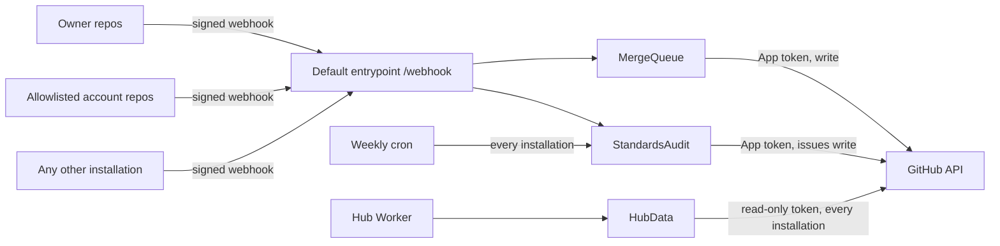

# Threat model: making the App public

- **Date:** 2026-10-20
- **Scope:** switching the GitHub App's installation setting from "Only on this account" to "Any account", so that accounts other than `Isma-L154` can install Steward. The first candidate is `Wal-014/Personal-Progress-List` ([Wal-014/Personal-Progress-List#98](https://github.com/Wal-014/Personal-Progress-List/issues/98)). This model assesses the security implications and the technical feasibility (Isma-L154/Steward#37). It does not implement anything. Out of scope: the GitHub Marketplace, paid plans, and the other account's own setup (ruleset, Dependabot security updates).

## How Steward behaves today

Today Steward trusts every installation it hears from. "Only on this account" is the only boundary. If the App were made public without changes:

- **Webhooks:** every signed delivery is acted on, whichever account sent it (`webhooks/events.py` takes `installation.id` from the payload). Every installation shares one webhook secret.
- **Weekly sweep:** it audits every repository of every installation (`installation_ids` → `sweep`), against the owner's rules: `OWNER_EMAIL`, the README standard, `AGENTS.md`, and AI attribution.
- **Hub API:** `HubData` reads every installation (`account_repos`), so other accounts' private repositories would appear on the owner's hub.
- **Limits:** the account's Cloudflare limits (Workers Free: 50 subrequests per invocation, daily requests and Durable Object usage) and `WEBHOOK_LIMIT` (120 per minute per client IP; GitHub delivers from a shared pool of IPs) are shared by everyone.

## Elements

| Assets | Actors | Entry points | Trust boundaries |
|---|---|---|---|
| App private key: write access (contents, pull requests, issues) to every installed repository, of every account | Owner (`Isma-L154`) | `POST /webhook` (signed with the App's single secret) | GitHub → `steward.cloudils.com` (signed deliveries from any installation) |
| Other accounts' private repositories: code metadata, PRs, issues, alerts | Allowlisted second account (`Wal-014`), trusted with its own repositories only | Weekly cron (`scheduled`) | Steward → other accounts' repositories (merges, labels, issues written as the App) |
| Owner's hub data and its confidentiality | Any GitHub account that installs a public App (anyone with the install link) | Hub API (service binding, already modeled in `2026-10-19-hub-api.md`) | Repository content (workflow YAML, Dependabot config, titles) → Steward's parsers: becomes attacker-controlled |
| Availability: the merge queue, audits, the hub, and the account's free-plan quotas | Collaborators on other accounts' repositories | | Installations → shared Cloudflare quotas and rate limits |

## Data flow

## Threats

| # | STRIDE | Threat | Likelihood | Impact | Existing control | Gap | Mitigation | Verification |
|---|---|---|---|---|---|---|---|---|
| 1 | E / D | Any account installs the public App, and Steward acts on its repositories: merges, labels, standards issues, and use of the owner's quotas | High once public (the install link is public) | High | "Only on this account", which is exactly what is being removed | No account check anywhere: an installation is trusted because it exists | An allowlist of accounts (`ALLOWED_ACCOUNTS`, a non-secret var, empty means the owner only) checked fail-closed by one pure function at every entry: the webhook (repository owner), the sweep (installed repositories' owner) and the merge queue job. On `installation.created` from another account, Steward deletes the installation (`DELETE /app/installations/{id}` with the App JWT), so a stranger stops costing deliveries. | Unit tests: a signed webhook from a non-allowlisted owner queues nothing; the sweep skips its repositories; an `installation` event from it calls the delete endpoint; an empty or missing allowlist means the owner only |
| 2 | I | Other accounts' private repositories appear on the owner's hub: names, PR titles, CI state and security alert counts | Certain without a change | Medium (privacy of the other account; the owner is already trusted with write access, but the hub was not part of what they agreed to) | None | `HubData` reads every installation | The hub reads only the owner's account: filter installations to the owner's login before the GraphQL query | Unit test: `account_repos` given an owner installation and an allowlisted one returns only the owner's repositories |
| 3 | T | The standards audit judges other accounts by the owner's rules (commit email, README, `AGENTS.md`, AI attribution) and opens issues they never asked for | Certain without a change | Medium (noise and reputation, not a breach) | `steward-ignore`, which also turns off merges | No way to separate merges from standards | Standards run only on the owner's account (a second, separate check from #1): webhook-triggered audits and the sweep skip other accounts | Unit tests: a push to `main` of an allowlisted repository queues the merge evaluation but no audit; the sweep audits only the owner's repositories |
| 4 | D | A busy or hostile installation sends enough deliveries to spend `WEBHOOK_LIMIT` (per client IP, shared by all GitHub senders) or the daily request quota. The owner's deliveries are refused with 429, and GitHub does not retry them automatically. | Medium | High (missed merges and audits for the owner) | `WEBHOOK_LIMIT` per IP; signature check | The limit is keyed by IP, not by account (global rule 10 control 5: per account, not only per IP) | After the signature check, add a second limit keyed by installation id, below the shared one, so one installation cannot spend another's budget. Mitigation #1 removes strangers entirely. | Integration test: deliveries past the per-installation limit from installation A answer 429, while a delivery from installation B in the same minute is accepted |
| 5 | D | Repository content becomes attacker-controlled input: a huge or alias-heavy workflow or `dependabot.yml` makes an audit exceed the CPU limit. Pyodide does not recover in that isolate (#5), and other Durable Objects of the class may share it. | Low with the allowlist, Medium without it | Medium | One audit per Durable Object call; `yaml.safe_load` (no code execution); the blob text comes from GitHub's API | No size limit on parsed files | Skip parsing any workflow or Dependabot file over a fixed size (for example 64 KiB) and report it as unreadable; with #1, only allowlisted accounts' files are parsed | Unit test: an oversized workflow is reported as `workflow-unreadable` without calling `yaml.safe_load` |
| 6 | E | A leaked App private key, or a bug that writes to the wrong repository, now reaches other accounts' repositories with write access | Low | High (a breach in someone else's account) | The key is a Worker secret; installation tokens are short-lived; the hub uses a read-only token | The blast radius grows with each installation | Ask allowlisted accounts to install with "Only select repositories". Keep the requested permissions unchanged (no new write scopes). Document in `SECURITY.md` that the App acts on allowlisted accounts and how to report an issue. | Manual check before enabling: `GET /app/installations` shows only allowlisted accounts, each with `repository_selection: selected` |
| 7 | R | The other account cannot tell what Steward did, or the owner cannot show it later. Worker logs keep 3 days. | Low | Low | Every write is made as the App's bot on GitHub, which keeps its own history (PR timeline, labels, merge commits) | Logs are short-lived | None needed: GitHub's timeline is the audit trail and cannot be edited by Steward | Not applicable |

## Feasibility

Making the App public is technically feasible. The flip itself is one setting in the App's GitHub settings, but it must come only after the mitigations above. The work is small and fits Steward's structure:

- **One PR with the account policy (threats 1 to 3).** A pure `account_policy(login) -> (merges, standards, hub)` in the core, fed by `ALLOWED_ACCOUNTS` and the owner's login, and applied at the webhook, the sweep, the merge queue and `HubData`. Each entry point already has a filtering step (`is_managed`) where this check fits. The `installation` event also needs a payload model in `webhooks/events.py` for the self-uninstall. [Opus 5: touches every entry point, security boundary]
- **One PR with the per-installation webhook limit (threat 4).** One more rate-limit binding in `wrangler.toml` and a call after the signature check. [Sonnet 5: small, well specified]
- **One PR with the parse size cap (threat 5).** [Sonnet 5: routine]
- **The switch and the installation** (threat 6), done by hand by both owners: make the App public, then `Wal-014` installs it on `Personal-Progress-List` only. Then they add the ruleset with required checks there, without which Steward never merges.

Not security, but still open from Wal-014/Personal-Progress-List#98: Steward prefers squash merges when a repository allows them (`github/client.py`, `merge_method`), and that repository uses merge commits. Either Steward follows the repository's preference or the repository disables squash there. This does not affect the model.

Scale: the weekly sweep makes 1 + Σ(2 + repositories) subrequests and the free plan allows 50 per invocation. With standards limited to the owner (threat 3), other accounts add nothing to the sweep. The hub refresh adds nothing either if it reads only the owner (threat 2).

Recommendation: feasible and acceptable once threats 1 to 5 are mitigated. Until then, the App stays "Only on this account".

## Open mitigations

- [ ] Account allowlist, fail-closed at every entry, with self-uninstall of other accounts (1). Verified by the webhook, sweep and installation-event tests.
- [ ] Hub reads only the owner's account (2). Verified by the `account_repos` filter test.
- [ ] Standards only on the owner's account (3). Verified by the push and sweep tests.
- [ ] Per-installation webhook rate limit (4). Verified by the integration test with two installations.
- [ ] Size cap on parsed YAML (5). Verified by the oversized-file test.
- [ ] "Only select repositories" for allowlisted accounts, and `SECURITY.md` updated (6). Verified by the installation listing check before enabling.

## Accepted risks

- **The installer trusts the operator.** An account that installs Steward gives the owner's App write access to the repositories it selects. That is inherent to any GitHub App, and Steward does not reduce it beyond requesting no new permissions.
- **GitHub's link-to-PR delay and other behavior shared with the owner's repositories** apply to allowlisted accounts in the same way (for example #36). Nothing extra is needed.
